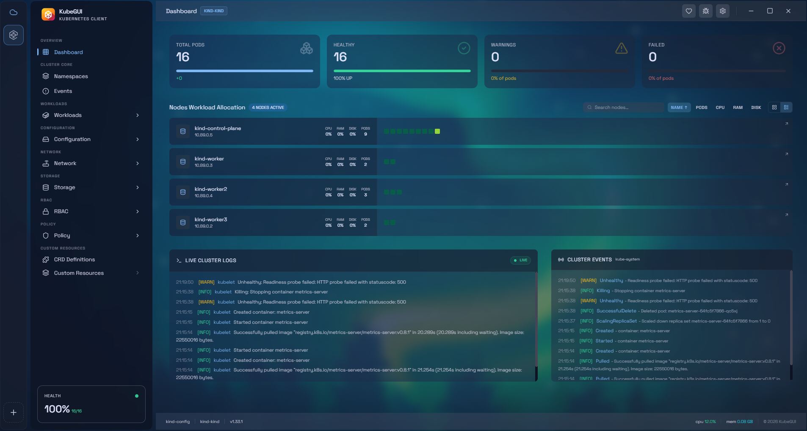

# KubeGUI - Kubernetes UI / admin desktop application
Official website - https://kubegui.net  

[](https://buymeacoffee.com/jurijskobex)

[](https://github.com/gerbil/kubegui/actions/workflows/release.yml) [](https://github.com/gerbil/kubegui/actions/workflows/codeql.yml)  

  

# Features
> - Browse and manage Kubernetes resources with intuitive controls  
> - See changes as they happen with live updates  
> - Full support for Custom Resource Definitions (CRDs) + example generator 
> - Work seamlessly across multiple clusters
> - Powerful built-in resource editor with YAML validation and syntax highlighting  
> - No external dependencies — no kubectl required  
> - View Deployments, DaemonSets and single Pod logs with context aware highlighting  
> - Open a shell directly into your workloads (even to Nodes via admin daemonset) 
> - Automatic application updates, no manual installs  
> - Portforwarding support  
> - Network policy graph (native/cilium)
> - Whoami/auth check view
> - Whoami/auth check view
> - Resource quota details visualisation
> - RBAC roles/bindings graph/flow view
> - Settings to change ui font/size
> - Trivy cve scans (ondemand)
> - Application auto update based on newer version from Github
> - Helm respos+charts and releases (views)
> - AI suggestions for issues/errors/warnings/etc

## TODO:

- ArgoCD rollout/apps flow view

## DEVELOPMENT

- Rebuild all & run app in dev mode
wails3 task dev:all
- Rebuild react frontend app only
wails3 task install:frontend:deps
- Regenerate backend wails service bindings
wails3 task generate:bindings
- Run dev frontend (vite+react)
wails3 task dev:frontend
- Run dev wails app (backend)
wails3 task dev:backend

Pre-release checks:  
- All tests passed
- Windows and Mac prod versions built and tested
- All release notesand changelog updated
- Version bump - `version=x.x.x wails3 task release`

Post-release checks:  
- Check and fix FOSSA license and security issues

Release builds:  
```
version=2.0.0 wails3 task build:windows:prod
version=2.0.0 wails3 task build:mac:prod
```

Release for MAC (winlinx versions are released via GitHub actions):  
```
version=2.0.0 wails3 task release:mac:prod
```

Release sign (win):   
```
(bash)
cd ./bin
curl -skL https://github.com/gerbil/kubegui/releases/latest/download/kubegui-windows-x86_64.zip -O kubegui-windows-x86_64.zip
unzip kubegui-windows-x86_64
(cmd only)
cmd /C signtool sign /n "Jurijs Kobecs" /t http://time.certum.pl/ /fd sha256 /v kubegui.exe
-- pin manually
del kubegui-windows-x86_64.zip
zip -FSr kubegui-windows-x86_64.zip kubegui.exe
delete existing kubegui-windows-x86_64.zip in github release - via gh client
upload to github release - via gh client
del kubegui.exe
del kubegui-windows-x86_64.zip
```
